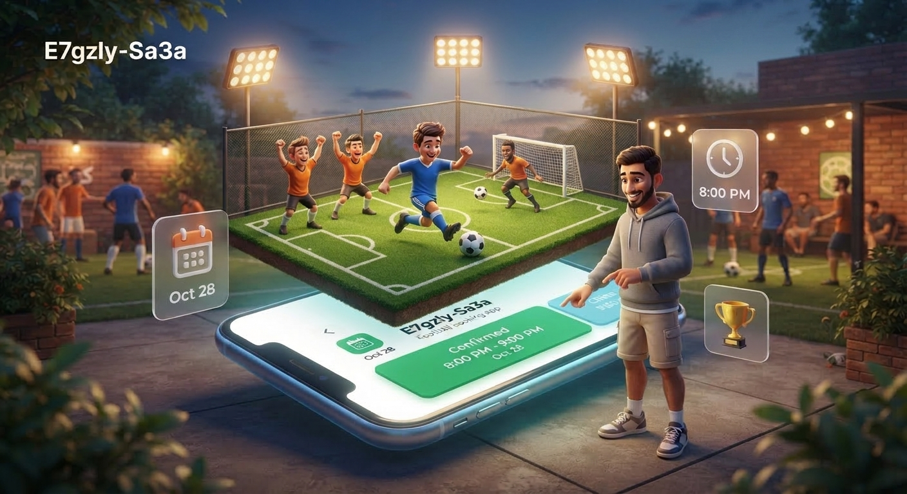

# ⚽ E7gzly-Sa3a – Football Club Booking System

<p align="center">
  
</p>


**E7gzly-Sa3a** ("Book Me an Hour") is a modern web application designed to streamline the process of reserving football pitches. Instead of calling the club or visiting in person, players and team captains can browse available pitches, check real-time schedules, and book their preferred time slots online.

---

## 📋 Table of Contents
- [Project Idea](#-project-idea)
- [Tech Stack](#-tech-stack)
- [Main Features](#-main-features)
  - [Customer Portal](#1-customer-portal)
  - [Admin Dashboard](#2-admin-dashboard)
- [Booking Workflow & Statuses](#-booking-workflow--statuses)
- [Suggested Database Schema](#-suggested-database-schema)
- [Installation & Setup](#-installation--setup)

---

## 💡 Project Idea

The primary goal of **E7gzly-Sa3a** is to make football pitch reservations faster and easier while keeping every field owner’s workspace private. One Owner account is associated with one field. A shared application can serve multiple owners, but every booking, block, and schedule is scoped to its owner. The platform is a multi-tenant booking service. Each Owner is provisioned by the platform Super Admin and manages exactly one field. Players access a field-specific booking page. Owners cannot browse or access other owners’ fields, schedules, players, or bookings. The platform connects three roles:

* **Customers (Players):** Browse pitches, view pricing and capacity, check real-time slot availability, and manage their reservations.
* **Field Owners:** Manage their own field schedule, approve/reject booking requests, and manage players for that field only.
* **Super Admin:** Creates, activates, and manages Owner accounts.

---

## 🛠 Tech Stack

* **Backend:** Laravel (PHP Framework)
* **Frontend:** HTML5, CSS3, JavaScript (Blade Templates)
* **Database:** MySQL / MariaDB
* **Authentication:** Laravel Breeze  (Role-based access control)

---

## ✨ Main Features

### 1. Customer Portal
* **Authentication:** Secure user registration, login, and profile management.
* **Pitch Discovery:** Browse all active football pitches at the club.
* **Detailed Pitch Views:** Inspect pitch names, high-quality images, hourly rates, and player capacity (e.g., 5v5, 7v7, 11v11).
* **Real-Time Availability:** Interactive date and time-slot checker to prevent double bookings.
* **Seamless Booking:** Reserve a pitch for a specific date and duration in a few clicks.
* **Reservation Management:** View upcoming and past bookings in a personal dashboard.
* **Self-Service Cancellation:** Cancel upcoming reservations if they fall within the club's allowed cancellation window.
* **Live Status Tracking:** Monitor booking progress (`Pending`, `Confirmed`, `Cancelled`, `Completed`).

### 2. Field Owner Dashboard
* **Secure Admin Access:** Dedicated login portal for club administrators.
* **Analytics Overview:** At-a-glance dashboard displaying key metrics (total bookings, registered customers, active pitches, and revenue).
* **Schedule & Working Hours:** Configure club operating hours and block out unavailable dates or times.
* **Reservation Control:** View all incoming customer bookings with filtering options by date or status.
* **Approval Workflow:** Confirm or reject `Pending` booking requests.
* **Customer Directory:** View and manage registered users and their booking histories.
* **Complete Booking Logs:** Access full historical records of all club reservations.

---

## 🔄 Booking Workflow & Statuses

Every reservation goes through a clear lifecycle:

| Status | Description |
| :--- | :--- |
| 🟡 **Pending** | The customer has submitted a booking request and is awaiting admin confirmation. |
| 🟢 **Confirmed** | The admin has approved the booking, and the time slot is officially locked. |
| 🔴 **Cancelled** | The booking was cancelled by the customer (within policy) or rejected by the admin. |
| 🔵 **Completed** | The match date and time have passed, and the reservation is archived. |


---

## 🚀 Installation & Setup

Follow these steps to run the project locally:

1. **Clone the repository**
   ```bash
   git clone https://github.com
   cd e7gzly-sa3a
   ```

2. **Install PHP dependencies**
   ```bash
   composer install
   ```

3. **Environment Configuration**
   ```bash
   cp .env.example .env
   php artisan key:generate
   ```
   *Update your `.env` file with your local database credentials (`DB_DATABASE`, `DB_USERNAME`, `DB_PASSWORD`).*

4. **Run Database Migrations**
   ```bash
   php artisan migrate --seed
   ```

5. **Start the Local Development Server**
   ```bash
   php artisan serve
   ```
   Visit `http://127.0.0.1:8000` in your browser.


## Tenant Isolation (Frontend Demo)

- Each Owner account is linked to exactly one field (`tenantId`).
- The Owner dashboard, schedule, pending requests, confirmed bookings, and blocked-player list are filtered to that field.
- Public player sign-up creates Player accounts only. Owner accounts are provisioned by the platform Super Admin.
- A player booking page is field-specific, for example `/?field=green-arena` or `/?field=champions`. The sign-in/sign-up flow carries the selected field context.
- Demo Owner accounts: `owner@e7gezly.demo` (Green Arena), `champions@e7gezly.demo` (Champions Park), `yard@e7gezly.demo` (The Yard), and `stadiumx@e7gezly.demo` (Stadium X). Use the Demo Owner button or select Owner and use one of these email addresses.

**Production security note:** this is a static frontend demo. Filtering in JavaScript is for demonstrating the UX only. The Laravel API must derive the authenticated Owner's `owner_id` on the server and scope every booking, schedule, and block query by it. Never trust a client-supplied `owner_id` or `tenantId`.
